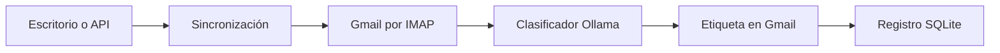

# Email Agent

**Clasificación de Gmail con modelos locales, etiquetas personalizables y auditoría en SQLite.**

MVP en Python que consulta mensajes de Gmail, los clasifica mediante Ollama y aplica la etiqueta correspondiente. Incluye una API con FastAPI y una interfaz de escritorio con CustomTkinter.

## Qué demuestra

- Un flujo de IA conectado con un servicio real mediante IMAP.
- Salida estructurada validada con Pydantic.
- Separación de lectura, clasificación, sincronización y persistencia.
- Registro local para evitar procesar de nuevo los mismos mensajes.
- Pruebas con dobles de Gmail y Ollama.

## Funcionalidades y alcance

| Disponible | Pendiente |
| --- | --- |
| Consulta de mensajes según una búsqueda de Gmail | Generación de borradores de respuesta |
| Categorías configurables en YAML | Aprobación y rechazo de respuestas |
| Clasificación con Ollama y aplicación de etiquetas | Envío de respuestas |
| Historial de procesamiento en SQLite | Validación de uso en producción |
| API y aplicación de escritorio | |

La sincronización **modifica etiquetas en Gmail**. Para una demostración, utiliza una cuenta de prueba y mensajes ficticios.

## Arquitectura



**Stack:** Python, FastAPI, CustomTkinter, Ollama, Pydantic, SQLite, YAML y pytest.

El clasificador envía remitente, asunto y hasta 4.000 caracteres del cuerpo al servidor Ollama configurado. Con Ollama ejecutado localmente y un modelo local, esa inferencia se realiza en el equipo; Gmail sigue siendo un servicio remoto. Una configuración remota o de nube de Ollama cambia ese límite de privacidad.

## Requisitos

- Python 3.11 o posterior, con soporte gráfico Tk para la aplicación de escritorio.
- Ollama en ejecución y un modelo descargado:
  ```bash
  ollama pull llama3.1
  ```
- Una cuenta Gmail con acceso IMAP y una contraseña de aplicación disponible según su configuración. No se utiliza la contraseña habitual de la cuenta.

## Instalación

```bash
git clone https://github.com/alejandroomesa/email-agent.git
cd email-agent
python -m venv .venv
```

Activa el entorno:

```powershell
# Windows PowerShell
.\.venv\Scripts\Activate.ps1
```

```bash
# macOS / Linux
source .venv/bin/activate
```

```bash
python -m pip install -r requirements.txt
```

## Configuración

Copia `.env.example` a `.env` y completa los valores de tu cuenta de prueba:

```dotenv
GMAIL_ADDRESS=tu_correo@gmail.com
GMAIL_APP_PASSWORD=REEMPLAZAR
OLLAMA_MODEL=llama3.1
GMAIL_QUERY=in:inbox is:unread
```

`.env` y `data/` están excluidos de Git. La contraseña se guarda en texto en el archivo local `.env`; protege el acceso a ese archivo y no lo incluyas en capturas o grabaciones.

En `app/categories.yaml`, cada categoría define:

| Campo | Uso |
| --- | --- |
| `name` | Identificador de categoría |
| `description` | Criterio que recibe el clasificador |
| `gmail_label` | Etiqueta que se aplica en Gmail |

Variables opcionales:

| Variable | Valor predeterminado |
| --- | --- |
| `OLLAMA_MODEL` | `llama3.1` |
| `GMAIL_QUERY` | `in:inbox is:unread` |
| `CATEGORIES_PATH` | `app/categories.yaml` |
| `DB_PATH` | `data/agent.db` |

## Aplicación de escritorio

Con el entorno virtual activo:

```bash
python run_desktop.py
```

La aplicación organiza bandeja, categorías y ajustes en vistas independientes. Configura los datos de prueba antes de iniciar una sincronización.

## API local

```bash
python -m uvicorn app.main:app --reload --host 127.0.0.1
```

Documentación interactiva: [localhost:8000/docs](http://localhost:8000/docs).

| Método | Ruta | Función |
| --- | --- | --- |
| GET | `/categories` | Consultar categorías |
| POST | `/sync` | Leer, clasificar y etiquetar mensajes |
| GET | `/processed?limit=50` | Consultar el registro local |

La API no implementa autenticación. Mantén su acceso local.

## Pruebas

```bash
python -m pytest -v
```

Las pruebas de clasificador, cliente Gmail y almacenamiento usan dobles para las integraciones. No sustituyen una comprobación manual de escritorio, IMAP y modelo local.

## Recorrido de demostración

1. Prepara mensajes ficticios sin leer en una cuenta de prueba.
2. Define dos o tres categorías claramente distintas.
3. Inicia el escritorio o la API y ejecuta una sincronización.
4. Comprueba la clasificación, las etiquetas en Gmail y el registro local.
5. Repite la sincronización para observar cómo se omiten mensajes ya registrados.

## Límites conocidos

- La clasificación puede equivocarse; la confianza del modelo no es una garantía.
- El cuerpo utilizado para clasificar se limita a 4.000 caracteres.
- No hay aprobación previa al etiquetado.
- El registro SQLite y el archivo de configuración requieren protección local.
- No se generan ni envían respuestas.

## Estructura

- `app/gmail_client.py`: consulta y etiquetado mediante IMAP.
- `app/classifier.py`: clasificación con Ollama.
- `app/sync_service.py`: coordinación del flujo.
- `app/storage.py`: registro SQLite.
- `app/main.py`: API FastAPI.
- `app/desktop/`: interfaz gráfica.
- `tests/`: pruebas automatizadas.

Desarrollado en el repositorio de [Alejandro Mesa](https://github.com/alejandroomesa).
